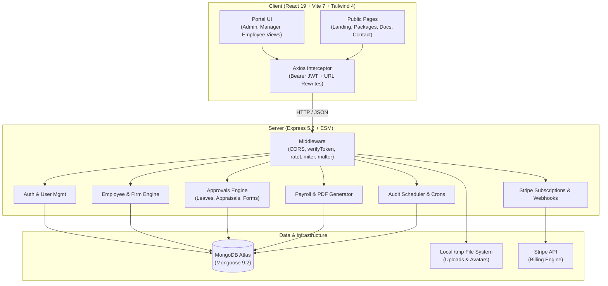

# Strativa HRMS / ERP — Comprehensive Technical Analysis Report

**Date:** November 2026  
**Target Codebase:** `strativa-deploy` (`client` & `server`)  
**Architecture:** React 19 SPA (Vite) + Node.js Express 5 REST API + MongoDB (Mongoose 9)  
**Deployment Target:** Vercel Serverless (Client & API) / Node.js persistent runtime  

---

## 1. Executive Summary

**Strativa** is a full-featured, multi-tenant Human Resource Management System (HRMS) and Corporate Operations ERP. The system encompasses marketing and corporate landing pages, subscription packages with Stripe integration, and a role-based internal portal for **Employees**, **Managers**, **CEOs**, and **Super Admins**.

### Core Platform Capabilities
- **Workforce Administration:** Employee onboarding, multi-firm organization isolation, profile records, and departmental shifts.
- **Attendance & Time Tracking:** Web check-in/check-out, working hours calculation, late status detection, and automated missing punch audits.
- **Leave Management:** Custom leave quotas (casual, medical, special, annual), document attachment support, and approval workflows.
- **Performance & Forms:** Annual appraisals, Key Performance Indicators (KPI), Direct Financial Incentives (DFI), and custom dynamic form builder.
- **Compensation & Payroll:** Attendance-adjusted salary calculations, deduction breakdown (tax, loss of pay, provident fund), and automated PDF payslip generation (`pdfkit`).
- **Internal Collaboration:** Scoped internal employee-to-employee messaging and system notification dispatch.

While the feature scope and domain design are extensive and practical, the analysis revealed several **critical security exposures** (hardcoded database credentials, unprotected PII endpoints, missing authorization guards) and **architectural bottlenecks** (sequential all-manager approval loops, ID collision risks, and serverless file persistence limits).

---

## 2. System Architecture & Tech Stack



### Technology Breakdown

| Layer | Technologies & Libraries | Notes |
| :--- | :--- | :--- |
| **Frontend Framework** | React 19.2, React Router 7.13, Vite 7.3 | Single-page application, Tailwind CSS 4.2, Lucide icons, Motion |
| **Backend Framework** | Node.js (ESM), Express 5.2 | Asynchronous controllers, REST architecture |
| **Database & ODM** | MongoDB Atlas, Mongoose 9.2 | Multi-tenant collections linked via `firm_id` |
| **Authentication** | JWT (`jsonwebtoken` 9.0), `bcrypt` 6.0 | Role-based tokens with client-side local storage |
| **File Handling** | Multer 2.1 | Stored in `./uploads` or `/tmp/uploads` on Vercel |
| **Payments & Billing** | Stripe SDK 23.1 | Monthly subscription checkout sessions, webhooks, and eligibility verification |
| **Document Generation** | PDFKit 0.20 | Server-side binary PDF streaming for payslips |
| **Background Processing** | `node-cron` 4.6 + Vercel Cron routes | Nightly missing-punch checks, rate limit cleanup, and payroll draft generation |

---

## 3. Critical Security & Vulnerability Findings

> [!CAUTION]
> The following vulnerabilities pose immediate risks of data breaches, privilege escalation, and credential exposure. They require immediate mitigation.

### 3.1. Hardcoded MongoDB Atlas Credentials (Severity: CRITICAL)
- **Location:** [db_connection.js](file:///c:/Users/Asad/Desktop/strativa-deploy/server/src/config/db_connection.js#L13-L15)
- **Detail:** The source code contains a plaintext production MongoDB Atlas connection string with embedded username and password (`asadkaptech_db_user:apexion-strativa@ac-q3go0yc-...`) as `FALLBACK_DB_URL`.
- **Impact:** Anyone with read access to the repository or decompiled server bundle has full administrative read/write access to the entire cluster database.
- **Remediation:** Immediately rotate the database user credentials in MongoDB Atlas. Remove the fallback string and enforce that `process.env.DB_URL` must be provided; if missing, throw an exception and refuse to start.

### 3.2. Unauthenticated Sensitive PII Exposure (Severity: CRITICAL)
- **Location:** [profileRoutes.js](file:///c:/Users/Asad/Desktop/strativa-deploy/server/src/routes/profileRoutes.js#L13-L16) and [profileController.js](file:///c:/Users/Asad/Desktop/strativa-deploy/server/src/controllers/profileController.js#L16-L80)
- **Detail:** `GET /profile/:id` has **no authentication middleware** (`verifyToken` is completely absent).
- **Impact:** Any unauthenticated visitor on the internet can iterate over user ObjectIds and scrape:
  - Full Name, Email, Phone Number, CNIC (National ID Card Number), Date of Birth, Marital Status
  - Exact Monthly Salary (`employee_salary`)
  - Complete Bank Account details (`bank_name`, `account_title`, `account_number`, `iban`)
- **Remediation:** Mount `verifyToken` on `profileRoute`. Enforce that a user can only view their own profile unless they possess `admin` or `manager` roles within the same `firm_id`.

### 3.3. Unprotected Password Reset & Profile Modification (Severity: CRITICAL)
- **Location:** [profileRoutes.js](file:///c:/Users/Asad/Desktop/strativa-deploy/server/src/routes/profileRoutes.js#L14-L15)
- **Detail:**
  1. `PUT /profile/:id/change-password` does not verify JWT tokens or rate-limit attempts. An attacker knowing or brute-forcing a user's current password (often default `"123"`) can take over any account.
  2. `PUT /profile/:id/upload-image` allows unauthenticated file uploads to any user's profile.
- **Remediation:** Add `verifyToken` and `checkLoginRateLimit` middleware, and verify `req.user.user_id === req.params.id`.

### 3.4. Broken Object-Level Authorization (BOLA) & Privilege Escalation (Severity: HIGH)
- **Location:** [employeeRoute.js](file:///c:/Users/Asad/Desktop/strativa-deploy/server/src/routes/employeeRoute.js#L15-L16) and [employeeController.js](file:///c:/Users/Asad/Desktop/strativa-deploy/server/src/controllers/employeeController.js#L216-L288)
- **Detail:**
  - `employeeRoute.use(verifyToken)` is present, but neither `updateEmployee` nor `deleteEmployee` checks for `admin` or `manager` privileges.
  - The check only verifies `existing.firm_id === req.user.firm_id`.
- **Impact:** Any regular employee (`user` role) can issue a `PUT /user/update-employee/:id` request to alter their own or a colleague's `employee_salary`, change `is_manager: true`, or issue `DELETE /user/delete-employee/:id` to wipe employee records.
- **Remediation:** Apply `requireManagerOrAdmin` or `requireAdmin` middleware to all mutation routes in `employeeRoute.js`.

### 3.5. Unauthenticated Leave Types CRUD (Severity: HIGH)
- **Location:** [leaveTypeRoutes.js](file:///c:/Users/Asad/Desktop/strativa-deploy/server/src/routes/leaveTypeRoutes.js#L6-L16)
- **Detail:** None of the leave-type routes (`/admin/add-leave-type`, `/admin/update-leave-type/:id`, `/admin/delete-leave-type/:id`) have token verification or admin role guards. Anyone can alter global company leave policies.
- **Remediation:** Mount `verifyToken` and `requireAdmin` on `leaveTypeRoute`.

### 3.6. Hardcoded JWT Secret Fallback (Severity: MEDIUM)
- **Location:** [authController.js](file:///c:/Users/Asad/Desktop/strativa-deploy/server/src/controllers/authController.js#L155) & [authMiddleware.js](file:///c:/Users/Asad/Desktop/strativa-deploy/server/src/middleware/authMiddleware.js#L11)
- **Detail:** Falls back to `"supersecretkeyforstrativaerp"`. If `JWT_SECRET` is unset in production, forged tokens can be minted by any party knowing this public repo string.

---

## 4. Logic Bugs & Architectural Bottlenecks

### 4.1. The "Every Manager in Database" Sequential Approval Deadlock
- **Location:** [LeavesController.js](file:///c:/Users/Asad/Desktop/strativa-deploy/server/src/controllers/LeavesController.js#L69-L109), [formController.js](file:///c:/Users/Asad/Desktop/strativa-deploy/server/src/controllers/formController.js#L13-L70)
- **Flaw:**
  ```javascript
  const managers = await Users.find({ user_role: "manager" }).sort({ _id: 1 });
  const myIndex = managers.findIndex(m => m._id.toString() === req.user.user_id.toString());
  const isMyTurn = myIndex === approvedCount && r.leave_status !== "rejected";
  ```
  - **Cross-Tenant Leak:** `Users.find({ user_role: "manager" })` does not filter by `firm_id`. Managers from Company A must review leaves from Company B!
  - **Order Dependency:** Approval requires all managers in MongoDB creation order (`_id: 1`). If Manager #2 is on leave or inactive, all company requests are locked permanently.
  - **Scale Failure:** A company with 10 department managers requires 10 approvals for a single 1-day casual leave.
- **Fix:** Approval should be single-tier by the employee's direct reporting manager or department head within their specific `firm_id`.

### 4.2. Low-Entropy ID Generation & Crash via Unique Key Collisions
- **Location:**
  - `generateEmployeeCode.js`: Uses `Date.now().toString().slice(-3)` (only 1,000 possibilities per initial pair).
  - `appraisals.js` & `dfi.js`: `form_no` default is `FORM-${Math.floor(Math.random() * 1000)}` with a `unique: true` index.
- **Flaw:** By the Birthday Paradox, a collision occurs with >50% probability after only ~37 form submissions or employee creations, resulting in uncaught MongoDB duplicate key errors (`E11000`) and failed requests.
- **Fix:** Use monotonic auto-incrementing sequences per firm (e.g., `APEX-EMP-00142`, `APEX-APP-2026-0042`) or cryptographic UUIDs (`crypto.randomUUID()`).

### 4.3. Missing `firm_id` on New Submissions Causing Data Disappearance
- **Location:** [appraisalController.js](file:///c:/Users/Asad/Desktop/strativa-deploy/server/src/controllers/appraisalController.js#L17-L25), [DFIController.js](file:///c:/Users/Asad/Desktop/strativa-deploy/server/src/controllers/DFIController.js#L28-L34)
- **Flaw:** When an employee submits an Appraisal, KPI, or DFI, `firm_id` is never set on the newly saved document. However, `formController.js` fetches requests using `{ firm_id: req.user.firm_id }`.
- **Impact:** Submissions immediately become "invisible" to managers filtering by their firm.

### 4.4. Notification Recipient ID Mismatch
- **Location:** [LeavesController.js](file:///c:/Users/Asad/Desktop/strativa-deploy/server/src/controllers/LeavesController.js#L169-L192)
- **Flaw:** LeavesController creates notifications using `employee._id` (the `Employee` collection document ID). However, `notificationController.js` queries notifications using `req.user.user_id` (the `User` collection document ID).
- **Impact:** Employees never receive leave approval or rejection notifications in their portal.

### 4.5. Ephemeral File Storage on Vercel Serverless
- **Location:** [app.js](file:///c:/Users/Asad/Desktop/strativa-deploy/server/src/app.js#L45-L53)
- **Flaw:** Server writes uploads to `/tmp/uploads` on Vercel. Serverless lambdas are ephemeral and spin down after inactivity.
- **Impact:** All employee profile pictures, uploaded medical prescriptions, and attachments are permanently lost on serverless restarts.
- **Fix:** Connect an external object store such as Cloudinary, AWS S3, or Supabase Storage.

---

## 5. Payroll & Attendance Logic Evaluation

### Payroll Computation (`payrollController.js`)
```javascript
const baseSalary = Number(employee.employee_salary) || 120000;
```
1. **Falsy Zero Bug:** If an employee has salary recorded as `0` (e.g. unpaid intern, trainee, or new record), JavaScript evaluates `0 || 120000` to `120,000 PKR`.
2. **Hardcoded Allowance Structure:** HRA (25%), Medical (10%), and Special Allowance (5%) are hardcoded percentages added on top of base salary for all employees regardless of contract terms.
3. **Absence Deduction Gap:** Deductions only calculate against existing `Attendance` records. Unrecorded dates are treated as 0 absence rather than checking against calendar business days.

### Attendance Check-in (`attendanceController.js`)
1. **Hardcoded 9:30 AM Cutoff:** Late calculation ignores `assigned_shift` start times (`assigned_shift.start_time`), incorrectly penalizing evening and night shift workers.
2. **Server UTC Mismatch:** When hosted on Vercel (UTC timezone), evaluating `new Date().getHours()` at 9:30 AM Pakistan Standard Time (PKT, UTC+5) compares against 4:30 AM UTC, disrupting automated late marking.

---

## 6. Frontend Code Quality & Performance

### 6.1. Single Monolithic Bundle (1.2 MB JavaScript)
- Vite build produces a single **1,198 kB** JS bundle (`dist/assets/index-*.js`).
- Public landing pages, marketing assets, admin forms, and PDF viewers are loaded upfront before the user even logs in.
- **Recommendation:** Implement route-level code splitting using `React.lazy()` and `Suspense`:
  ```jsx
  const AdminFirms = React.lazy(() => import('./portal/admin/Firms'));
  const EmployeeChat = React.lazy(() => import('./portal/chat/EmployeeChat'));
  ```

### 6.2. ESLint Failures (35 Errors, 7 Warnings)
- React 19 rules in `LiveChat.jsx` flag `Date.now()` invoked directly in render bodies.
- Synchronous `setState` calls inside `useEffect` bodies in `Navbar.jsx`, `Header.jsx`, and `Packages.jsx` trigger cascading re-renders.
- Unused variables and icons across 14 components.

### 6.3. Third-Party Dependency Risk
- In [Header.jsx](file:///c:/Users/Asad/Desktop/strativa-deploy/client/src/portal/base/Header.jsx#L39), an unauthenticated HTTP fetch polls `https://abacus.jasoncameron.dev/get/strativa-hrms.com/visitors` every 30 seconds. Outages or latency on this personal endpoint directly degrade portal header responsiveness.

---

## 7. Prioritized Remediation Roadmap

| Priority | Category | Action Item | Target File(s) |
| :---: | :--- | :--- | :--- |
| **P0** | **Security** | Remove hardcoded MongoDB URI; rotate Atlas credentials; enforce `process.env.DB_URL`. | `server/src/config/db_connection.js` |
| **P0** | **Security** | Protect `/profile/*` routes with `verifyToken`; prevent unauthenticated PII leakage. | `server/src/routes/profileRoutes.js` |
| **P0** | **Security** | Add role checks (`requireAdmin`, `requireManagerOrAdmin`) on employee update/delete & custom forms. | `server/src/routes/employeeRoute.js`, `customFormRoutes.js` |
| **P1** | **Data Integrity** | Add `firm_id` to `raiseAppraisal`, `raiseDFI`, `raiseKPI` submissions. | `appraisalController.js`, `DFIController.js`, `KPIController.js` |
| **P1** | **Business Logic** | Replace global sequential manager loop with firm-scoped single-tier or hierarchy approval. | `LeavesController.js`, `formController.js` |
| **P1** | **Bug Fix** | Route leave notifications to `User._id` instead of `Employee._id`. | `LeavesController.js` |
| **P1** | **Reliability** | Replace 3-digit random number generation with UUIDs or atomic sequence counters. | `generateEmployeeCode.js`, `appraisals.js`, `dfi.js` |
| **P2** | **Infrastructure**| Integrate Cloudinary / S3 for persistent file uploads in serverless production. | `server/src/middleware/uploadMiddleware.js` |
| **P2** | **Performance** | Code-split client routes with `React.lazy()` to reduce initial bundle from 1.2MB to <250kB. | `client/src/App.jsx` |
| **P2** | **Code Hygiene**| Clean up `npm` and `install` extraneous packages from `server/package.json`; resolve 35 ESLint errors. | `server/package.json`, client components |

---

## 8. Conclusion

**Strativa HRMS** is an impressively feature-complete project with high commercial potential. Its UI styling, comprehensive HR pipelines (appraisals, leaves, attendance, payroll, custom forms, chat), and multi-firm vision are well-conceived. 

Resolving the immediate **P0 security vulnerabilities** and **P1 workflow logic bugs** highlighted above will make the codebase secure, production-grade, and enterprise-ready.
